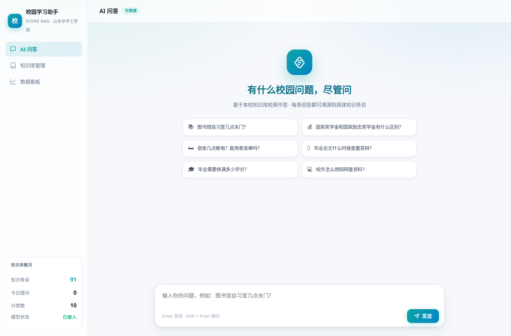
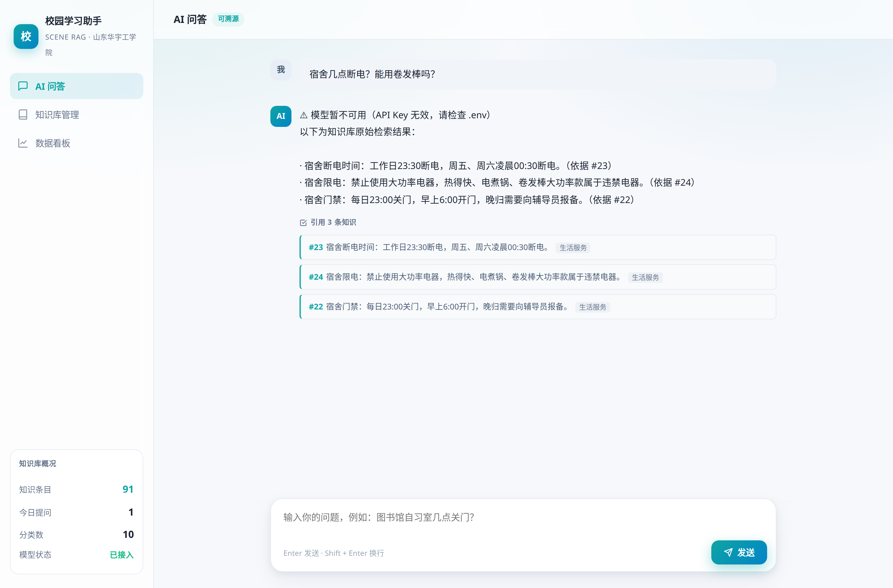
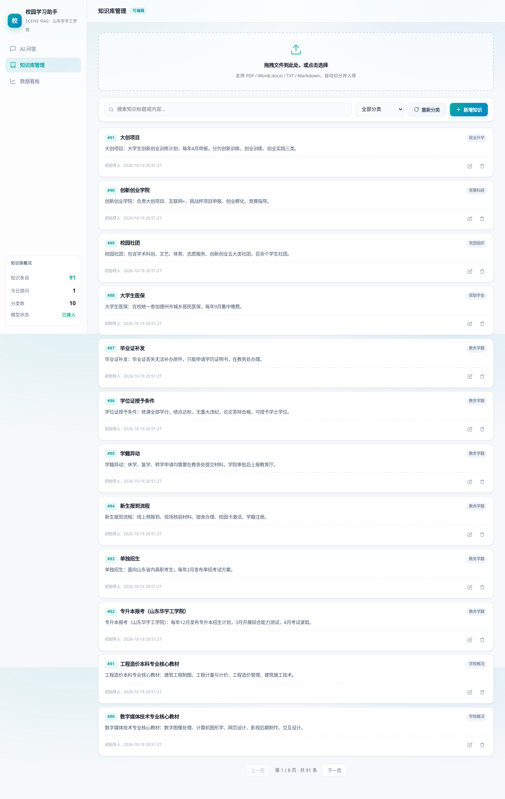
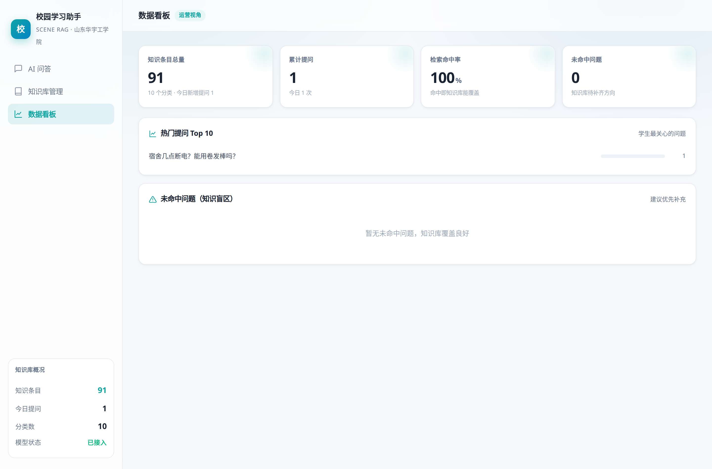
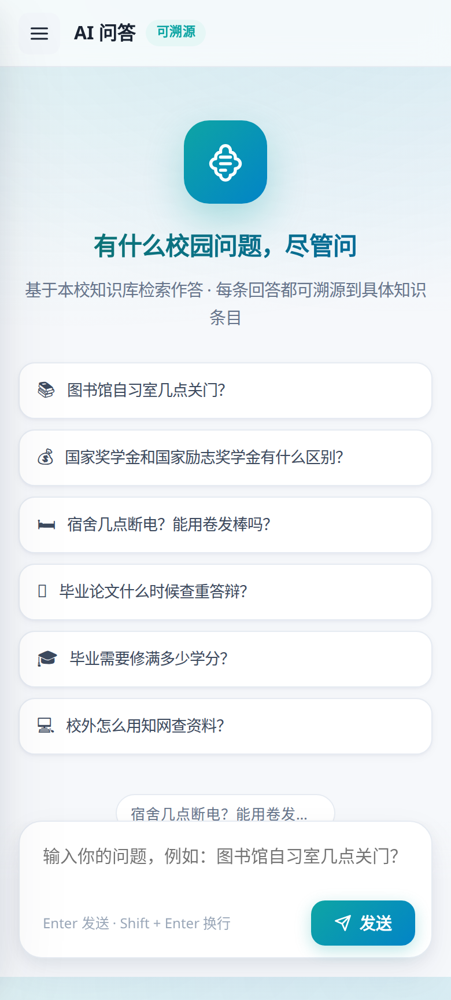

# 场景化轻量 RAG 知识库 · 校园学习助手

> AI 创新应用挑战赛参赛项目（个人赛）
> 基于山东华宇工学院真实校园信息构建的智能问答系统，已上线运行。

**在线演示**：部署于云端，7×24 小时可访问（演示地址见参赛材料）

---

## 一、项目简介

大学生获取校园信息（考试安排、奖助学金、场馆开放时间等）长期依赖"问学长、翻群聊、看官网"，信息分散且容易过期。本项目将学校真实校园信息构建为结构化知识库，学生用自然语言提问，系统**优先从老师维护的校内资料中检索生成有据可依的回答**；知识库未覆盖的问题自动由大模型答疑兜底。

**核心设计理念——双来源可溯源标注**：

| 回答类型 | 页面标注 | 依据明细 |
|---|---|---|
| 来自校内知识库 | 📚 依据老师上传的校内资料 | 引用条目编号、上传教师、上传日期、原始文件名 |
| 大模型直接生成 | 🤖 由 AI 生成（校内暂未收录） | 明确提示"重要信息请与老师核实" |

学生永远知道答案从哪来——这是通用大模型聊天机器人做不到的。

## 二、核心功能

- 🎯 **场景化问答**：专注校园学习场景，支持多轮对话与上下文追问
- 🪶 **轻量检索**：自研中文 bigram + IDF 逆文档频率加权 + 校园同义词扩展，**无需向量数据库**，2 核 2G 普通服务器即可运行
- 🔍 **双来源溯源**：校内资料 / AI 生成双模式标注，来源精确到"哪位老师、哪天、哪个文件"；回答中的引用编号可点击，自动展开并高亮对应条目原文
- 👨‍🏫 **教师共建知识库**：教师上传 PPT / Word / PDF / Excel 自动切分入库，学生可在"学习资料"页在线查看与下载原文件
- 👥 **四级账号体系**：学生（学号登录）/ 教师（工号登录）/ 管理员 / 开发者，权限逐级收窄，密码加盐哈希存储
- 📋 **Excel 批量建号**：上传学生名单自动生成账号，初始密码 = 姓名拼音 + 学号后两位（自动处理姓氏多音字）
- 💬 **留言板**：知识库答不上的问题可留言，教师回复形成师生互动闭环
- 📊 **数据看板**：提问趋势、热门问题 Top10、知识盲区（未命中问题）、回答满意度（点赞/点踩）
- 🧪 **效果评测体系**：内置 30 题基准评测集，一键量化检索质量

## 三、效果评测

自建 30 题基准评测集（15 题库内 + 15 题库外，全部采用口语化问法而非原文复述），在数据看板中一键运行：

| 指标 | 基线（bigram 词频匹配） | **升级后（IDF + 同义词扩展）** |
|---|---|---|
| Top1 命中率 | 66.7% | **86.7%** |
| Top3 召回率 | 80% | **93.3%** |
| 库外拒识率 | 60% | **73.3%** |
| 平均检索耗时 | 1.3 ms | **1.6 ms** |

> 评测集源码 `eval-questions.json`，评测逻辑 `/api/eval/run`，可在数据看板中复现。

## 四、技术架构

```
浏览器（响应式前端，零框架依赖）
   │  SSE 流式传输
   ▼
Express (Node.js 22+)
   │
   ├─ 账号体系：scrypt 加盐哈希 + Token 会话，四级角色权限控制
   │
   ├─ 检索层（RAG 核心）
   │    ├─ 中文 bigram 切分 + 停用词过滤
   │    ├─ IDF 逆文档频率加权（稀有词高权重）
   │    ├─ 校园同义词扩展（比赛↔竞赛、饭卡↔一卡通 等 20 组）
   │    └─ 标题加权 + 长文惩罚 → Top-K 召回
   │
   ├─ 生成层：阿里云百炼 qwen-plus（OpenAI 兼容接口）
   │    ├─ 命中资料：带防编造约束的 Prompt，回答必须标注依据编号
   │    ├─ 未命中：切换 AI 答疑模式，标注"AI 生成"
   │    └─ 双重降级：Key 失效/网络异常 → 自动回退知识库原文，演示不断链
   │
   └─ 存储层：SQLite（Node 内置 node:sqlite，零编译依赖）
        knowledge / users / messages / feedback / board_messages / logs
```

**为什么是"轻量 RAG"**：向量数据库（Milvus、Pinecone）需要额外部署、GPU 资源和 Embedding 服务调用成本。本方案针对校园语料"条目短、实体明确"的特点，用纯 CPU 的统计检索达到接近语义检索的效果（Top3 召回 93.3%），单次检索 1.6ms，可运行在任何最低配云服务器上——**轻量不是妥协，是面向真实部署环境的设计选择**。

## 五、快速启动

```bash
# 1. 安装依赖（Node.js 22+）
npm install

# 2. 配置环境变量（详见下方表格）
cp .env.example .env   # 然后编辑 .env 填入你的 API Key

# 3. 启动
node server.js
# 浏览器打开 http://localhost:3000
```

首次启动自动完成：建表 → 导入 `knowledge.txt` 91 条校园知识 → 创建开发者初始账号。

## 六、环境变量

| 变量 | 必填 | 说明 |
|---|---|---|
| `DASHSCOPE_API_KEY` | 否 | 阿里云百炼 API Key，不填进入演示模式（直接返回检索原文） |
| `LLM_BASE_URL` | 否 | OpenAI 兼容接口地址，默认百炼 |
| `LLM_MODEL` | 否 | 模型名，默认 `qwen-plus`，可换 `qwen-turbo` / `qwen-max` |
| `PORT` | 否 | 服务端口，默认 3000 |
| `ADMIN_PASSWORD` | 否 | 开发者初始账号密码，默认 `dev123456` |

> 百炼 Key 获取：https://bailian.console.aliyun.com → API-KEY 管理

## 七、默认账号

| 角色 | 账号 | 密码 | 权限 |
|---|---|---|---|
| 开发者 | `developer` | 见 `.env.example` | 全部功能 + 创建管理员/教师/学生账号 |
| 教师 | 由开发者创建 | 创建时指定 | 上传资料、回复留言、创建学生账号 |
| 学生 | Excel 批量导入或教师创建 | 姓名拼音+学号后两位 | 问答、留言、查看资料 |

## 八、目录结构

```
rag-campus/
├── server.js             # 后端主程序（鉴权/检索/LLM/接口）
├── public/index.html     # 前端单页应用（问答/资料/留言/看板/账号管理）
├── knowledge.txt         # 初始校园知识库（91 条，自动导入）
├── eval-questions.json   # 30 题基准评测集
├── package.json          # 依赖清单
├── .env.example          # 环境变量模板
└── screenshots/          # 界面截图
```

## 九、界面截图

| 问答首页 | 问答效果（可溯源） |
|---|---|
|  |  |

| 知识库管理 | 数据看板 |
|---|---|
|  |  |

| 移动端适配 |
|---|
|  |

## 十、团队信息

- **参赛形式**：个人赛
- **姓名**：赵一
- **学校**：山东华宇工学院 · 信息工程学院
- **班级**：本科数据科学 2402

## 十一、技术说明

- 后端：Node.js 22+ / Express / node:sqlite（内置，无需编译原生模块）
- 前端：原生 HTML/CSS/JS 单页应用，SSE 流式渲染，零框架
- 大模型：阿里云百炼 DashScope（qwen-plus），OpenAI 兼容协议
- 部署：已发布公网演示环境；亦可在 2 核 2G 服务器一键部署